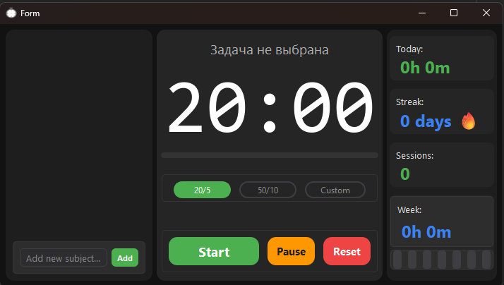
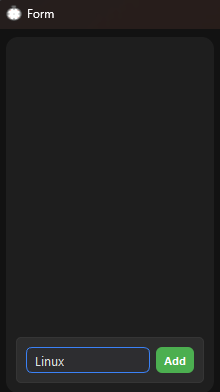
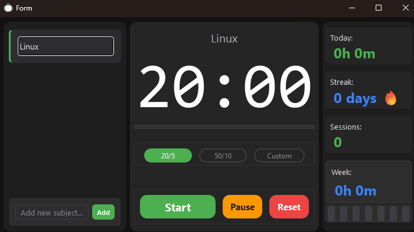
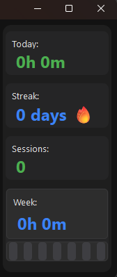

# LessonTime
Таймер для соблюдения времени работы и отдыха.



---
## Кому может помочь:
Причиной создания этого проекта стало моё выгорание. Я попросту забывал, когда должен отдыхать — всё
время были мысли вроде: «Ну, сейчас, ещё пара минут». И в итоге задерживался на несколько часов, и так почти всегда.
Поэтому я надеюсь, что этот проект поможет людям избегать таких ситуаций и не забывать об отдыхе.

## Установка:
Проект написан на `PyQt6` и встроенных библиотеках **Python**.
```
pip install PyQt6
```
или через файл зависимостей:
```
pip install -r requirements.txt
```

После установки запустите приложение:
```
python main.py
```

## Как пользоваться:
Как только вы запустите приложение, вы увидите главное окно таймера.

Перед использованием нужно сделать две вещи: выбрать режим таймера и написать задачу для фокуса.
### Режимы:

- `20/5` — данный режим создан для быстрых дел: уборка, мытьё посуды и т.д.
- `50/10` — режим для изучения нового и закрепления старого, также подходит для работы и многих других дел.
- `custom` — чтобы не навязывать вам мои временные рамки, вы можете указать удобное вам время на работу и отдых. Единственные ограничения: работать больше 60 минут без перерыва нельзя, отдыхать больше часа — тоже. Минимальное значение — 1 минута.

### Поле задач:
| Поле фокуса                     | Как пользоваться                                                                                                                                                                                     |
|---------------------------------|------------------------------------------------------------------------------------------------------------------------------------------------------------------------------------------------------|
|   | Для начала работы первоначально надо записать свою задачу. Можно воспользоваться горячей клавишей `Enter` или просто нажать на кнопку `Add`. После чего надо выбрать то, чем вы хотите заняться. Их также можно удалить на `ПКМ` |

Когда фокус и режим выбраны, единственное, что остаётся сделать — нажать `Start`.


Когда время фазы заканчивается, таймер сигнализирует об этом аудио — приятным бодрым женским голосом (сгенерированным ИИ).

### Аналитика:
| Поле аналитики                  | Today                                                            | Streak                                                           | Sessions                                                         | Week                                                                                                              |
|---------------------------------|------------------------------------------------------------------|------------------------------------------------------------------|------------------------------------------------------------------|-------------------------------------------------------------------------------------------------------------------|
|   | Этот счётчик показывает то, сколько вы **сегодня работали**      | Этот счётчик отображает то, сколько дней подряд вы **работали**  | Данный раздел показывает то, сколько раз вы сегодня занимались   | В этом разделе вы можете увидеть, сколько раз вы занимались на этой неделе и в какие дни недели вы занимались     |
---
### Важно:
- Запускался и тестировался на **Windows**. Теоретически должен работать
везде, где можно поставить Python и PyQt6 (Linux, macOS), но я это не проверял.
- Когда время таймера закончится, чтобы запустить его снова, нужно сначала нажать `Reset`, и только потом `Start`.
- Когда таймер запущен, вы всегда можете поставить его на паузу, за исключением отдыха — в этот момент поставить таймер на паузу **не выйдет**.
- Если вы закроете программу, она всё равно продолжит работать в фоне. Чтобы окончательно её выключить, надо выйти через `tray`.

## Лицензия
[MIT](LICENSE)
